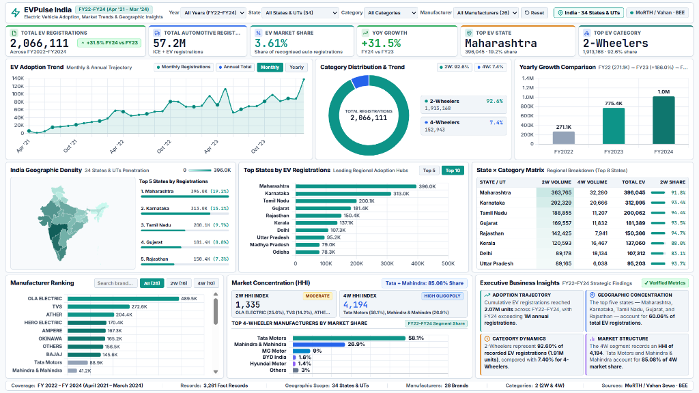

# EVPulse India: Electric Vehicle Market Analytics & Business Intelligence

[](https://python.org)
[](https://sqlite.org)
[](https://powerbi.microsoft.com)
[-teal.svg)]()
[]()

---

## Overview
**EVPulse India** is an end-to-end Data Analytics and Business Intelligence portfolio project evaluating the historical adoption trajectory, market penetration, regional distribution, and manufacturer competitive landscape of Electric Vehicles across India.

The analysis spans a 36-month historical observation window from **April 2021 to March 2024 (Fiscal Years 2022 to 2024)**, evaluating **2,066,111 EV registrations** benchmarked against **57,233,134 total automotive registrations** across **34 Indian States & Union Territories** and **26 manufacturers**.

---

## Business Problem
India's electric mobility transition under national frameworks such as FAME-II requires clear empirical visibility into multi-segment market dynamics:
1. **Adoption Velocity:** What is the actual adoption speed across vehicle categories (2-Wheelers vs. 4-Wheelers)?
2. **Geographic Concentration:** Which states and regions drive the bulk of EV adoption, and how do adoption rates differ from raw registration counts?
3. **Manufacturer Structure:** How concentrated is the OEM landscape, and what is the market structure (HHI) across segments?
4. **Infrastructure Alignment:** How does public charging station availability correlate with EV adoption volumes across states?

---

## Objectives
- Standardize, clean, and reconcile historical vehicle registration datasets from **MoRTH (Vahan Sewa)** and public charging station directories from the **Bureau of Energy Efficiency (BEE)**.
- Architect an analytical **Kimball Star Schema** relational database in SQLite with 100% referential integrity.
- Formulate **27 advanced SQL business queries** utilizing Common Table Expressions (CTEs), Window Functions, and aggregations.
- Build an interactive, executive-grade **Power BI dashboard** and a complementary **Full HD standalone web dashboard**.
- Maintain mathematical reconciliation across Python, SQL, and Power BI computation layers.

---

## Dataset
- **Primary Registration Data:** Ministry of Road Transport and Highways (MoRTH) / Vahan Sewa.
- **Charging Infrastructure:** Bureau of Energy Efficiency (BEE) Public Charging Station (PCS) directory.
- **Fact Records:** 3,261 total fact records (2,448 state-level monthly records + 813 manufacturer-level monthly records).
- **Scope:** 34 States & Union Territories, 26 Manufacturers, 2 Categories (2-Wheelers and 4-Wheelers).
- **Historical Period:** FY2022 to FY2024 (April 2021 to March 2024).

---

## Key Metrics

| Metric | Value | Analytical Context |
| :--- | :--- | :--- |
| **Total EV Registrations** | **2,066,111 units** | National cumulative EV volume across 36 consecutive months |
| **Total Automotive Registrations** | **57,233,134 units** | Benchmark automotive registrations (ICE + EV) across tracked segments |
| **National EV Market Share** | **3.61%** | Overall adoption rate ($2,066,111 / 57,233,134$) |
| **2-Year Volume CAGR** | **+93.91%** | Volume expansion from FY22 (271K) to FY24 (1.02M units) |
| **FY 2023 YoY Growth** | **+185.96%** | High-acceleration post-pandemic inflection year |
| **FY 2024 YoY Growth** | **+31.50%** | Sustained expansion crossing the 1 Million annual registrations threshold |
| **2-Wheeler Segment Share** | **92.60% (1,913,168)** | Dominant volume driver of Indian electrification |
| **4-Wheeler Segment Share** | **7.40% (152,943)** | Emerging segment influenced by charging infrastructure availability |
| **Top State by Volume** | **Maharashtra (396,045)** | 19.17% of all national EV registrations |
| **Top State by Penetration** | **Goa (7.95%)** | Highest adoption density relative to total automotive registrations |
| **Leading 2W Manufacturer** | **Ola Electric (489,473)** | 25.58% segment market share |
| **Leading 4W Manufacturer** | **Tata Motors (88,935)** | 58.15% segment market share (Tata + Mahindra = 85.08%) |
| **Public Charging Stations (PCS)** | **11,664 stations** | BEE operational public charging stations nationwide |
| **Infrastructure Ratio** | **177.1 EVs / PCS** | Measure of public charging network availability |

---

## Key Insights
1. **Adoption Inflection & Scale:** Cumulative EV registrations reached 2.07M units across FY22–FY24, with FY24 crossing 1 Million annual registrations (1,019,593 units, +31.50% YoY).
2. **Category Dynamics:** 2-Wheelers account for **92.60%** of recorded EV volume (1.91M units). 4-Wheelers represent **7.40%** (152.9K units), reflecting price sensitivity and charging ecosystem maturity.
3. **Geographic Concentration:** The top five states—**Maharashtra, Karnataka, Tamil Nadu, Gujarat, and Rajasthan**—account for **60.06%** of all national EV registrations.
4. **Market Concentration Disparity (HHI):**
   - **2-Wheeler Segment:** HHI Index of **1,335** (Moderate competition), led by Ola Electric (25.58%), TVS (14.25%), and Ather Energy (10.69%).
   - **4-Wheeler Segment:** HHI Index of **4,194** (High Oligopoly). Tata Motors (58.15%) and Mahindra & Mahindra (26.93%) jointly control **85.08%** of the 4W EV market.
5. **Infrastructure Alignment:** States with dense public charging networks (Maharashtra, Karnataka, Delhi) exhibit higher 4-Wheeler EV registration volumes.

---

## Dashboard

### Executive Dashboard Preview


### Visual Architecture & Components
- **Top Slicer Toolbar:** Multi-attribute filtering across Fiscal Year, State, Vehicle Category, and Manufacturer.
- **Executive KPI Strip:** 6 primary cards highlighting national volumes, market share, YoY growth, and segment leaders.
- **EV Adoption Trend:** 36-month registration trajectory with quarterly/yearly aggregation toggles.
- **Category Distribution & Trend:** Segment split donut chart (2W vs. 4W) with absolute volume metrics.
- **Yearly Growth Comparison:** Bar progression tracking FY22 (271.1K), FY23 (775.4K), and FY24 (1.02M).
- **India Geographic Density:** Density choropleth map paired with the Top 5 adoption states.
- **Top States by EV Registrations:** Regional adoption hubs ranking (Top 5 / Top 10 toggles).
- **State × Category Matrix:** Cross-tabular breakdown of 2W volume, 4W volume, total EV, and 2W share %.
- **Manufacturer Ranking:** Competitive performance of all 26 brands with segment filtering.
- **Market Concentration (HHI):** Dual HHI index indicators (2W: 1,335 Moderate | 4W: 4,194 High Oligopoly) and 4W market share ranking.
- **Executive Business Insights:** 4 structured takeaway cards summarizing strategic findings.

---

## Tools & Technologies
- **Python (3.11):** Pandas, NumPy, Matplotlib, Seaborn, SQLAlchemy
- **Database & Querying:** SQLite 3.45, ANSI SQL (CTEs, Window Functions, Aggregate Queries)
- **Business Intelligence:** Microsoft Power BI Desktop (`.pbix`), DAX Measures Library
- **Interactive Web Presentation:** HTML5, CSS3 (Grid & Flexbox), Vanilla JavaScript, Chart.js 4.4
- **Version Control:** Git, GitHub

---

## Project Structure
```
EV-Market-Analytics-India/
├── data/
│   ├── raw/                              # Original source CSV files
│   │   ├── electric_vehicle_sales_by_state.csv
│   │   ├── electric_vehicle_sales_by_makers.csv
│   │   ├── dim_date.csv
│   │   └── charging_stations_by_state.csv
│   ├── processed/                        # Star Schema dimension & fact tables
│   │   ├── dim_date.csv
│   │   ├── dim_state.csv
│   │   ├── dim_maker.csv
│   │   ├── dim_category.csv
│   │   ├── fact_state_sales.csv
│   │   └── fact_maker_sales.csv
│   ├── evpulse_india.db                  # Fully indexed SQLite analytical database
│   └── data_dictionary.md                # Metadata, attribute definitions, and table grain
│
├── notebooks/
│   ├── 01_data_understanding.ipynb       # Profiling, null audits, and data validation
│   ├── 02_data_cleaning.ipynb            # ETL transformations and Star Schema construction
│   └── 03_eda.ipynb                      # Exploratory Data Analysis and statistical trends
│
├── python/
│   ├── config.py                         # File paths and environment constants
│   ├── data_cleaning.py                  # Automated ETL & dimensional modeling pipeline
│   ├── load_database.py                  # Database builder & automated SQL test harness
│   ├── analysis.py                       # Statistical calculations & visual figure generation
│   ├── generate_notebooks.py             # Reproducible notebook generator
│   ├── generate_dashboard_pages.py       # Analytical visual page generator
│   └── generate_html_dashboard.py        # Web dashboard build script
│
├── sql/
│   ├── 01_schema.sql                     # DDL: Star Schema tables, keys, constraints, indexes
│   ├── 02_data_quality.sql               # Integrity tests (nulls, referential integrity, parity)
│   ├── 03_kpi_queries.sql                # Executive KPI calculation queries
│   └── 04_business_analysis.sql          # 27 advanced business queries (CTEs, Window Functions)
│
├── powerbi/
│   ├── EVPulse_India_Dashboard.pbix      # Interactive multi-page Power BI dashboard
│   ├── dax_measures.md                   # Documented production DAX measures library
│   ├── powerbi_data_model.md             # Semantic model documentation & schema wireframe
│   └── evpulse_light_theme.json          # Corporate report theme JSON
│
├── web_dashboard/                        # Production Full HD (1920×1080) web dashboard
│   ├── index.html                        # Semantic dashboard layout & visual components
│   ├── style.css                         # Power BI inspired styling & responsive typography
│   ├── script.js                         # Cross-filtering engine, Chart.js visuals, KPI logic
│   └── README.md                         # Web dashboard user guide
│
├── reports/
│   ├── business_insights.md              # Strategic business findings and analysis report
│   └── powerbi_dashboard_preview.html    # Standalone dashboard preview
│
├── screenshots/                          # Dashboard & analytical chart visuals
│   ├── EVPulse-India-Dashboard.png       # Executive dashboard screenshot
│   ├── 01_monthly_ev_trend.png
│   ├── 02_yearly_growth_trend.png
│   ├── 03_top_bottom_states.png
│   ├── 04_state_penetration_rate.png
│   ├── 05_oem_market_share.png
│   └── 06_charging_infrastructure_correlation.png
│
├── requirements.txt                      # Python environment dependencies
├── .gitignore                            # Version control exclusion rules
└── README.md                             # Main project documentation
```

---

## Data Preparation
1. **Audit & Profiling:** Ingested raw datasets to verify data types, missing records, date boundaries, and negative value constraints.
2. **Kimball Dimensional Modeling:** Designed a Star Schema to support multidimensional slicing:
   - **Fact Tables:** `fact_state_sales` (state-level monthly registrations), `fact_maker_sales` (OEM-level monthly registrations).
   - **Dimension Tables:** `dim_date` (calendar & fiscal hierarchies), `dim_state` (states, regions, charging stations), `dim_maker` (OEMs & categories), `dim_category` (vehicle segment definitions).
3. **Reporting Anomaly Management:** Documented an isolated Vahan non-electric reporting anomaly for Kerala in January 2024 without mutating ground-truth facts.
4. **Volume Reconciliation:** Verified exact reconciliation between independent reporting entities:
   - `SUM(fact_state_sales.electric_vehicles_sold) = 2,066,111`
   - `SUM(fact_maker_sales.electric_vehicles_sold) = 2,066,111`
   - Variance: **0 units**.

---

## Analysis
- **Time Intelligence:** Monthly trajectory, YoY growth rates, 2-year CAGR (+93.91%), and 3-month rolling moving averages.
- **Geographic Penetration:** Volume ranking vs. adoption percentage (e.g., Goa achieves 7.95% penetration despite moderate absolute volume).
- **Market Concentration:** Herfindahl-Hirschman Index (HHI) computed across segments to distinguish competitive structure (2W HHI = 1,335 vs. 4W HHI = 4,194).
- **Infrastructure Stress:** State-by-state EV-to-PCS ratios to identify charging infrastructure bottlenecks.

---

## How to Run

### 1. Clone the Repository
```bash
git clone https://github.com/AyushGupta205/EV-Market-Analytics-India.git
cd EV-Market-Analytics-India
```

### 2. Set Up Python Environment
```bash
python -m venv .venv
source .venv/bin/activate  # On Windows: .venv\Scripts\activate
pip install -r requirements.txt
```

### 3. Run Data Processing & Database Build
```bash
python python/data_cleaning.py
python python/load_database.py
```

### 4. Generate Analytical Visuals
```bash
python python/analysis.py
```

### 5. Explore Power BI Reports
Open `powerbi/EVPulse_India_Dashboard.pbix` in Microsoft Power BI Desktop.

### 6. Launch Standalone Web Dashboard
Open `web_dashboard/index.html` in any modern web browser (Edge, Chrome, Firefox) at Full HD resolution (1920×1080).

---

## Results
- Achieved **100% numerical parity** across Python dataframes, SQLite query results, and Power BI DAX measures.
- Established an audited single source of truth for historical Indian EV adoption across FY2022–FY2024.
- Quantified high market concentration in the 4-Wheeler segment (Tata + Mahindra = 85.08% market share).

---

## Limitations
- **Historical Scope:** Dataset covers April 2021 to March 2024; does not include real-time, live, or post-FY2024 registrations.
- **Vehicle Segments:** Restricted to 2-Wheelers and 4-Wheelers (3-Wheelers and Commercial Buses excluded per dataset scope).
- **Infrastructure Granularity:** BEE Public Charging Station data reflects aggregate state totals rather than monthly installation milestones.

---

## Future Improvements
- Extend the ETL pipeline to ingest FY2025 and ongoing quarterly Vahan releases.
- Expand segment coverage to incorporate electric 3-Wheelers, E-Buses, and Commercial Light Vehicles.
- Correlate state-level adoption rates with state EV subsidies and tax exemptions to assess policy effectiveness.
